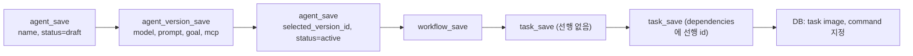

# agent / workflow 만들기 (agent-mcp 도구 사용)

agent-mcp 도구(`agent_*`, `workflow_*`, `task_*`)로 agent와 workflow를 만들 때 따르는 절차와, 실제로 만들면서 겪은 함정을 정리한다. 작성 규칙의 원본은 `guide_get(topic=authoring)`이며, 저장 도구를 쓰기 전에 먼저 읽는다. 서버 구조는 `agent-mcp-server.md`를 본다.

## 1. 생성 순서



1. `agent_save`로 껍데기를 draft로 만든다.
2. `agent_version_save`로 실행 설정을 저장한다. 저장해도 자동 선택되지 않는다.
3. `agent_save`로 `selected_version_id`와 `status=active`를 지정한다. 이 단계가 빠지면 실행되지 않는다.
4. `workflow_save` 후 `task_save`를 선행 task부터 만든다. 후행 task의 `dependencies`에 선행 task id를 넣는다.
5. task의 image와 command를 DB에서 바꾼다 (4장).
6. 실행 도구(`run_create`, `agent_run`)는 보류 상태라 사용자가 화면이나 API로 실행한다. 실행은 비용과 부작용이 있으니 요청 없이 하지 않는다.

## 2. 버전 저장 시 주의

- **필수 항목(`agent_id`, `model`, `description`, `system_prompt`, `goal`)은 수정할 때도 실제 값을 보낸다.** "값을 보낸 항목만 반영"이라는 설명과 달리 필수 항목에 넣은 문자열은 그대로 저장된다. `"(unchanged)"` 같은 자리표시자를 넣었다가 prompt와 goal이 덮어써진 적이 있다. 기존 버전을 `agent_version_get`으로 읽어 전체 값을 다시 보낸다.
- `version`을 보내지 않으면 0으로 저장된 적이 있다. 수정 시 기존 `version` 번호를 함께 보낸다.
- 저장 후 반환값으로 prompt, goal, mcp, version을 확인한다.

## 3. 버전 설정값

| 항목 | 기준 |
|---|---|
| `model` | 허용 목록을 조회할 수 없다. 동작 중인 agent의 값을 복사한다. 현재 worker는 `anthropic/claude-haiku-5-5`, verifier는 `anthropic/claude-sonnet-5-5` |
| `verifier_model` | 결과 품질이 중요하면 지정. 되돌릴 수 없는 동작(발송 등)을 하는 agent는 비운다 (재시도가 재발송을 부를 수 있음) |
| `mcp` | 문자열 배열 `["<connection id>"]`. 도구 정의는 object로 선언돼 있지만 배열이 저장된다 |
| `max_retry` | 기본 3. 부작용 있는 agent는 1 |
| `max_tokens` | 기본 5000. 도구 인자로 긴 본문을 보내는 agent(메일 등)는 8000 이상 |

### mcp connection id (spinx 11-12 변경 이후)

- spinx는 요청한 id를 **호출한 앱키가 쓸 수 있는 connection**(앱 소유 또는 global, approved, 연결 정상)으로 검사한다 (`aidea-api-spinx/service/mcp.go` `ExplainUnservable`).
- agent는 설정의 `x-api-key`로 spinx를 호출하므로, connection도 그 앱키로 만들었거나 global이어야 한다. id는 그 앱키로 `GET /spinx/mcp?scope=all&approval_status=approved`를 호출해 얻는다.
- 맞지 않으면 spinx가 `mcp connection not found; use the connection id from /spinx/mcp`(404)를 돌려준다. agent의 `spinxCall`은 상태 코드를 보지 않아서 `agent_run.reason`에는 `spinx response is empty`로만 남는다. 이 사유가 반복되면 mcp id부터 의심한다.

## 4. task image와 command

- `task_save`로는 image와 command를 지정할 수 없다. 생성 시 `amazon/aws-cli:2.28.12` + `["env"]`로 고정된다 (`aidea-api-workflow/types/task.go` `ToModel`). 그대로 실행하면 Pod가 `env`만 찍고 끝난다.
- 실행 시 task 정의가 run_task에 스냅샷으로 복사되므로 **실행 전에** 바꾼다.
- 현재 사용하는 값: image `ax-harbor.cjmezzomedia.com/aidea/aidea-api-agent/dev:82`, command `["/app/workflow"]`. 태그는 배포에 따라 바뀐다.

```sql
-- 대상 확인 후 변경 (실행 검증은 하지 않은 쿼리)
SELECT name, image, command FROM v2_workflow_task
WHERE workflow_id = UNHEX(REPLACE('<workflow_id>', '-', '')) AND status = 1;

UPDATE v2_workflow_task
SET image = 'ax-harbor.cjmezzomedia.com/aidea/aidea-api-agent/dev:82',
    command = JSON_ARRAY('/app/workflow')
WHERE workflow_id = UNHEX(REPLACE('<workflow_id>', '-', '')) AND status = 1;
```

- task를 새로 만들면 다시 aws-cli로 채워진다. task를 추가·수정한 뒤에는 SELECT로 다시 확인한다.

## 5. prompt, goal, task, 실행 입력 나누기

| 위치 | 담을 것 | 예 |
|---|---|---|
| system_prompt | 역할, 일하는 방식, 도구 사용 규칙 | "google_search만 사용, 크롤링 금지, 검색 최대 3회" |
| goal | 결과물 조건만 (형식, 개수, 확인 불가 허용) | "기사 5건, 각 항목에 제목·링크·요약. 날짜 미확인은 '날짜 확인 안 됨'" |
| task 문구 | task마다 다른 값 | "주제: 광고·마케팅 분야의 AI 활용 사례" |
| 실행 입력(`instruction`) | 실행마다 다른 값, 모든 task가 참고 | "기준 기간: 지난달 / 리포트 연월 / 수신자" |

- 같은 agent를 task 여러 개에 쓰고 task 문구만 바꾸면 병렬 실행이 된다 (의존성 없는 task는 병렬).
- 선행 task 결과는 자동으로 후행 task에 `<upstreams>`로 전달된다. task 문구에 복사하지 않는다.
- 후행 agent가 읽을 형식은 선행 agent의 goal에 고정해 둔다 (예: 첫 줄 `## 주제:`, 리포트 첫 줄 `# 제목` = 메일 제목).
- goal에 절차("3곳 이상 검색한다")를 쓰지 않는다. Verifier는 결과만 보므로 검증할 수 없어 재시도만 반복된다.

## 6. 도구별 메모

- `google_search` (search connection): 키워드 최대 3개, 키워드당 상위 3건. `period`(`d7`, `w2`, `m1`, `y1` 형식, 생략 시 최근 1년)와 `language`(`ko`/`en`/`all`, 생략 시 ko). 결과에 발행일 필드가 없으므로 날짜를 필수로 요구하지 않는다. 특정 달 지정은 안 되며 월초에 `m1`이면 사실상 지난달이다.
- `web_crawling`: 페이지 본문을 통째로 가져와 토큰을 많이 쓴다. 꼭 필요할 때만 쓰고, 쓰면 leaf당 URL 1개와 `max_chars` 3000 정도로 제한한다.
- `send_mail` (notify connection): `@cj.net` 주소만, 한 번에 20명까지. 다른 도메인이 하나라도 있으면 전체 거부. 발송 agent는 `dry_run=true`로 먼저 확인하고, `sent: true`를 받으면 다시 호출하지 않게 prompt에 적는다.

## 7. 실행 결과 분석

- `run_list` → `run_task_list`로 어느 task에서 멈췄는지 본다.
- `agent_run_list` → `agent_run_get`으로 `reason`, `attempts`, `usages`, history를 본다. 분석 절차는 `guide_get(topic=tuning)`.
- 자주 본 사유
  - `spinx response is empty`: mcp connection id 문제일 가능성이 높다 (3장).
  - `interrupt signal received`: Pod 종료나 취소. agent 설정 문제가 아니다.
  - `agent did not pass within N turns`: goal이 모호하거나 달성할 수 없는 조건이 있다.

## 8. 현재 만들어 둔 리소스 (2026-11-12)

| 종류 | 이름 | id |
|---|---|---|
| agent | 기사검색도우미 (google_search, 주제는 task 문구) | `01a1ced9-62e5-7a5c-aa71-53e18c979a9f` |
| agent | 월간리포트에디터 (도구 없음) | `01a1ced9-62d1-7618-9f51-6eb9fefbe0b0` |
| agent | 메일발송도우미 (send_mail) | `01a1ceaf-ace9-7ef9-9eaf-655abc5a6a23` |
| workflow | AI 월간 소식 메일 | `01a1cedb-d4d0-7d72-8d08-13b024b08bd8` |

workflow 구조: 기사검색 3개(생성형 AI·에이전트 / 광고·마케팅 AI / 국내 AI 도입·정책) 병렬 → 월간 리포트 작성 → 메일 발송.

실행 입력 예:

```
기준 기간: 지난달
리포트 연월: 2026년 10월
수신자: heedoc.park@cj.net
```

상태: 3번 실행 모두 실패. 기사검색도우미의 `vD2O2Wn3A7`, 메일발송도우미의 `dYZOXZvp3X`가 agent 앱키로 쓸 수 있는 connection id인지 확인해야 한다 (3장).
